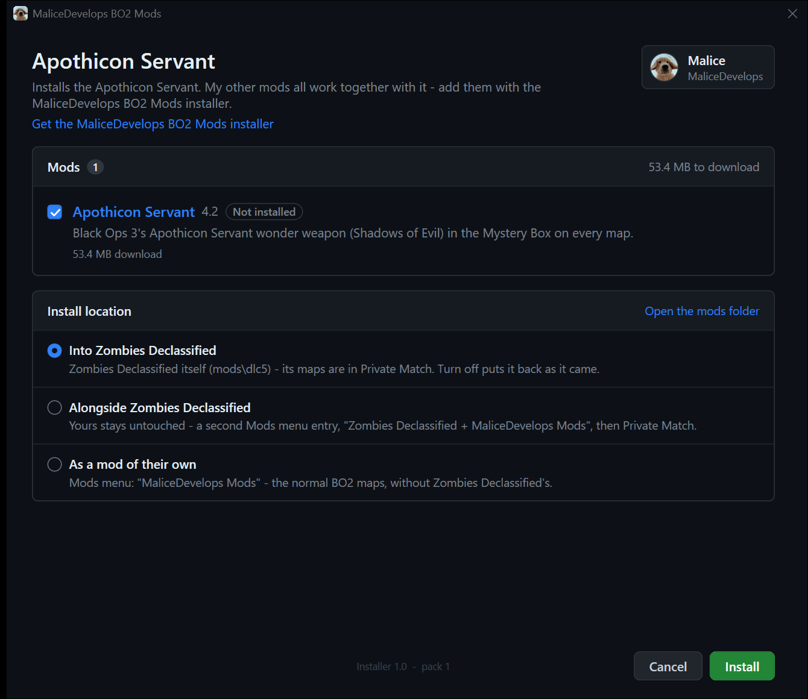

# Apothicon Servant for BO2 Zombies (Plutonium)

The Apothicon Servant from Black Ops 3's Shadows of Evil, ported to Black Ops 2 Zombies with its original model, animations, sounds and effects.

### [⬇ Download the latest version](https://github.com/MaliceDevelops/apothicon-servant-bo2/releases/latest)

Under **Assets**, download `Apothicon_Servant_v<version>.zip`.

## How it works

- **Mystery Box.** It follows BO2's wonder weapon rules: only one can be in play at a time. Each game the box has one of BO3's four: Kor-Maroth, Mar-Astagua, Nar-Ullaqua or Lor-Zarozzor.
- **Black hole.** Fire it and a black hole opens where the orb lands. Like in BO3, it drags in every zombie in range, including ones behind walls or outside the windows. It crushes them, then collapses in an explosion that kills the zombies around it.
- **Pack-a-Punch** turns it into the red **Arbgwaoth** version: longer black holes, bigger reach, more ammo.
- **Specials.** Hellhounds, Nova crawlers, monkeys, leapers, ghosts and denizens get pulled in too. **Bosses** (Brutus, Panzer Soldat...) aren't: they're held in place while the black hole is open and lose some health. Avogadro gets knocked back.
- **Maps.** It works on every BO2 zombies map, and on every **Zombies Declassified** map if you have it.

## Install

1. Close Black Ops 2.
2. Unzip the download anywhere and double-click **Install.bat**.
3. Choose where it goes, press **Install** and play:
   - **Into Zombies Declassified:** launch it like always. It works on its maps (in **Private Match**) and on the normal BO2 maps. To play Zombies Declassified without it, press **Turn off** in the installer (**Turn on** puts it back).
   - **Alongside Zombies Declassified:** your own Zombies Declassified stays exactly as it is, and the Mods menu gets a second entry with the mod. Pick **Zombies Declassified + MaliceDevelops Mods**, then **Private Match** for its maps.
   - **On its own** (the only choice without Zombies Declassified): open **Mods**, pick **MaliceDevelops Mods**, then play any map.

This download installs only the Apothicon Servant. Its window:



The installer stays on your PC: a **MaliceDevelops BO2 Mods** shortcut on your desktop and in the Start menu opens it again, so you don't need to keep the zip.

Install.bat needs Windows 10 or 11 and an internet connection. To install by hand instead, follow `README.txt` in the download.

Windows may warn about running a downloaded `.bat`. Install.bat only downloads my mods from github.com/MaliceDevelops (checking every file's SHA-256) and copies them; you can read `installer\install.ps1` to check.

## Want my other mods too?

They all work together in the same game (like the [Upgraded Cymbal Monkey](https://github.com/MaliceDevelops/upgraded-cymbal-monkey-bo2)). Get the **[MaliceDevelops BO2 Mods installer](https://github.com/MaliceDevelops/bo2-mods-installer/releases/latest)**: tick the mods you want and it downloads each one from its own page.

## Update, repair or move it

Open the **MaliceDevelops BO2 Mods** shortcut (or run Install.bat again). It always installs the newest version, keeps your settings, and doesn't download again what's already up to date. If it acts broken, press **Repair**: it downloads again only what's missing or damaged. Updating from an older version of the Apothicon Servant works the same way: the new Install.bat takes the old install over.

## Uninstall

Close BO2 and double-click **Uninstall.bat** (or press **Uninstall** in the installer). It removes the Apothicon Servant; any other mods of mine stay. It also puts back anything it set aside. The installer and its **MaliceDevelops BO2 Mods** shortcut stay, so you can install again; to remove them too, delete the shortcut and the folder `%LOCALAPPDATA%\MaliceDevelops`.

## Settings

Open the installer (the **MaliceDevelops BO2 Mods** shortcut) and press the Apothicon Servant's **Settings** button (or open `scripts\zm\zzz_aps_config.gsc` with Notepad). You can:

- turn the gun off on chosen maps,
- turn Pack-a-Punch off,
- turn off the Pack-a-Punch camo,
- let the creature say its combat and idle lines too (`creature_chatter`). It's off by default: in BO3 the creature only greets you when you get the gun.

Save, then start a new game. **Reset to defaults** puts back the mod's own settings. Your settings are kept when you update.

Updating from 4.1.1 or older keeps your old settings file, which has no `creature_chatter` line. To turn it on, add this line under the `pack_a_punch_camo` line:

```
level.aps_config[ "creature_chatter" ] = 1;
```

## Good to know

- **Co-op:** everyone in the game needs the same mods installed.
- **Other mods:** script mods like B2OP work fine alongside. Zombies Declassified has two free slots for mods that bring their own fastfile, and all of my mods together use one, so another fastfile mod can use the other.
- **Small:** all my mods share one small file (a few MB); each mod's textures, scripts and sounds are separate, and only installed mods' files are on your PC. To combine mods, use the [installer](https://github.com/MaliceDevelops/bo2-mods-installer/releases/latest).
- **After a Zombies Declassified update or install:** if the gun disappears from the box, open the installer and press **Repair**.

## Bugs

Open an [issue](https://github.com/MaliceDevelops/apothicon-servant-bo2/issues). Include:

- the map,
- whether you have Zombies Declassified,
- the line starting with `APS >>` from `%LOCALAPPDATA%\Plutonium\storage\t6\main\console_zm.log`.

## Changes

See [CHANGELOG.md](CHANGELOG.md).

## Credits

Ported by **MaliceDevelops**. Built with [OpenAssetTools](https://github.com/Laupetin/OpenAssetTools) and [Plutonium](https://plutonium.pw).

The Apothicon Servant's model, animations, sounds and effects are © Activision / Treyarch, from Call of Duty: Black Ops III. This is a free fan mod, not affiliated with or endorsed by Activision. Don't sell it.
